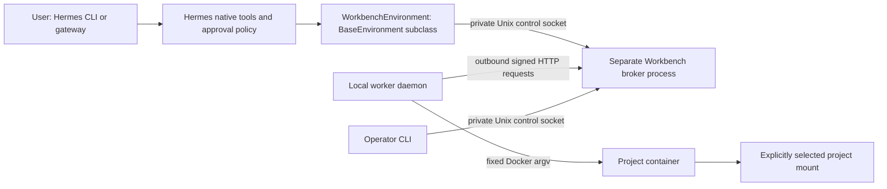

# Workbench Link architecture

This document preserves the design rationale and extended build targets. The implemented source, README, protocol, operations and runtime evidence define version 0.1.0 behavior. Some proposed module names and extended interfaces below remain design targets. Session-scoped foreground receipts, detached process identity and confirmed environment-stop evidence supersede the initial foreground-only lifecycle assumptions.

## 1. Outcome and engineering bar

Workbench Link connects Hermes's native terminal environment to one project selected on a local worker. A single target owns native `terminal`, `read_file`, `write_file`, `patch`, `search_files` and `execute_code` behavior. Hermes reasoning, memory, credentials and skill instructions stay on the Hermes host. Only command payloads, explicitly provided stdin and execution results cross the connection.

The product earns its place by preventing a familiar failure: reading on one machine, editing another filesystem and testing somewhere else. Existing SSH and device-tool plugins are real alternatives. The entry must demonstrate fewer tool-switching decisions and consistent native behavior, not merely another remote shell.

Engineering quality means each advertised behavior has an invariant, an explicit failure path and an observable validation. It does not mean unlimited scope. The seven-day event ends November 11, 2026 at 22:00 UTC / 23:00 Lagos. Prioritize the native workflow and its failure behavior over visual surfaces or protocol breadth.

## 2. Scope and release contract

| Area | Initial contract | Release gate |
|---|---|---|
| User surface | Native tools, management CLI, read-only status slash command; CLI first | Commands work without a frontend |
| Platform | Linux worker with Docker; Linux Hermes host | Supported OS tested; other OS unclaimed |
| Topology | One host, worker and project; one active CLI session/binding initially | Second conflicting binding refused |
| Selection | `terminal.backend: workbench_link` in a dedicated profile | Real profile isolation demonstrated |
| Execution | Foreground shell, exact stdin, cwd and exported-env persistence | Native routing and state tests |
| Files | Native read/write/patch/search in worker container | Server fixture unchanged; integrity proven |
| Recovery | Durable receipts and fencing of uncertain outcomes | Fault injection, no accidental replay |
| Cancellation | Request, acknowledged termination and uncertainty distinguished | Child-process/container cleanup proven |
| Network | Outbound worker HTTP; HTTPS outside loopback | Local path tested first; remote deployment separately verified |
| Security posture | Trusted plugin/worker owner; bounded container exposure | Credential, mount and approval tests |

Do not advertise fleet routing, live per-session target switching, arbitrary local MCP forwarding, SSH compatibility, screen/browser control, memory synchronization, rollback, transactional shell commands, exactly-once effects or universal sandbox security.

Native background/yield paths are not a marketing feature. Their lifecycle must either work correctly or be refused through a verified supported path. Lack of an advertised feature is insufficient if core can invoke it and leave a process behind. This is a runtime gate, not a license to silently ignore it.

## 3. Components and topology



**Plugin adapter:** registers the public provider, reads settings through `ctx.get_config`, reads its secret through `agent.secret_scope.get_secret`, and constructs an immutable environment binding. It never binds a network port or starts a worker during `register()`.

**Broker:** a separately launched plugin-owned process. It owns durable operation state and exposes two disjoint channels: an owner-only Unix control socket for Hermes/operator actions and a worker-only HTTP API. It is the sole writer of the host ledger. It does not execute user shell commands.

**Worker daemon:** runs on the project machine, opens the outbound connection, owns its own ledger and Docker environment, and selects the project path locally. The host does not have an API for choosing paths or image overrides. The worker never runs model-authored shell on its host OS.

**Container runner:** source shipped with the plugin and included in a locally built project image. It starts a bash child in an identified process group, streams exact output and records process termination. It is trusted launcher code, separate from the submitted shell string.

No vendor service, relay account, frontend build or paid API is needed for the local demonstration. For a real remote host, an operator-managed HTTPS reverse proxy exposes only the worker API. This avoids depending on private Hermes gateway authentication or WebSocket routing.

## 4. Why this transport

Use standard-library HTTP long polling initially: the worker polls for one queued dispatch, then uploads output and receipts while a separate heartbeat thread renews the lease. The agent cannot make an inbound connection to the laptop. This handles ordinary NAT layouts because the worker initiates every network request.

A separate broker process prevents a synchronous native tool from blocking the async server loop that would need to deliver its own response. The adapter only waits on local IPC and an independently progressing process handle. The broker, worker and runner have independent bounded loops.

Do not add WebSockets in the minimum. Duplex streaming, gateway ticket auth and reconnection libraries would add implementation and admission work without improving the central demonstration. Long polling carries a modest command-start delay; measure it and publish observed values, not speculative benchmarks.

The default worker poll timeout is two seconds. Heartbeats occur every three seconds; a lease expires after fifteen seconds without renewal. In an idle state the worker uses jittered backoff up to five seconds, resetting after a new dispatch. Cancellation and heartbeat use their own connections and cannot wait behind a long poll or full output upload.

## 5. Planned repository layout

```text
workbench_link/
├── plugin.yaml                  # native manifest and settings; no desktop component
├── __init__.py                  # relative import of package register(ctx)
├── pyproject.toml               # stdlib-only source package; no duplicate discovery entry point
├── README.md                    # install/use/disclosure/limits after implementation
├── ARCHITECTURE.md
├── PRODUCT.md
├── docs/                        # normative protocol, operations, validation and API contracts
├── workbench_link/
│   ├── plugin.py                # public ctx registration only
│   ├── settings.py              # validated immutable settings, profile-scoped secret capture
│   ├── provider.py              # TerminalEnvironmentProvider implementation
│   ├── environment.py           # BaseEnvironment adapter and result decoration
│   ├── process.py               # own ProcessHandle implementation using local pipe
│   ├── control.py               # Unix client/server, framing, deadlines, owner checks
│   ├── cli.py                   # Hermes management CLI argparse and status command
│   ├── errors.py                # stable product error codes and safe messages
│   ├── protocol.py              # exact schemas, canonical encoding, version checks
│   ├── auth.py                  # HMAC signing, nonce validation; no credential files
│   ├── broker/
│   │   ├── __main__.py          # explicit process entry, startup/shutdown
│   │   ├── service.py           # binding and operation state transitions
│   │   ├── http.py              # bounded worker HTTP endpoints
│   │   ├── store.py             # broker SQLite transactions and migration
│   │   └── leases.py            # monotonic deadlines and fencing
│   ├── worker/
│   │   ├── __main__.py          # standalone CLI entry
│   │   ├── client.py            # HTTP loop, auth, backoff and receipt resend
│   │   ├── service.py           # dedup, acceptance, dispatch and reconciliation
│   │   ├── docker.py            # fixed image/mount/resource policy, lifecycle
│   │   ├── project.py           # local path acceptance and identity
│   │   └── store.py             # worker durable dedup/receipt journal
│   └── runner/
│       └── __main__.py          # in-container process supervisor/control
├── container/Dockerfile         # source-built baseline, official base digest pinned
├── tests/
│   ├── unit/                   # state/auth/bounds/encoding tests
│   ├── integration/            # broker/worker/container/fault tests
│   ├── hermes/                 # real disposable Hermes registration/native tools
│   └── fixtures/               # tiny project, server decoy, process/error probes
├── dev/                         # local-only topology and test orchestration
├── evidence/                    # redacted real run outputs and environment versions
└── research/                    # migrated discovery inputs; raw snapshots ignored
```

Import the directory plugin relatively so Hermes's namespaced importer can load it. A standalone worker can run `python -m workbench_link.worker` from a source checkout or an explicitly installed source wheel. Verify both layouts. Do not rely on the plugin package being automatically pip-installed by directory discovery.

The worker must not import Hermes to start. Split shared protocol/auth code from Hermes-specific provider/settings imports. There is one implementation of the wire schema, shared by both processes, rather than two subtly different encoders.

## 6. Native Hermes adapter

### Registration and settings

Manifest identifier: `workbench-link`; terminal backend identifier: `workbench_link`; worker executable module: `workbench_link.worker`. These deliberately differ because backend names accept underscores, while catalog names use the plugin slug. Document the distinction once in setup.

Proposed manifest targets `requires_hermes: ">=0.23.0"`, version `0.1.0`, Python `>=3.11`, no third-party Python dependencies and no built-in override capabilities. Do not add a manifest-wide runtime API number without a validator requirement. Declare only the surfaces actually registered. No custom file/shell tools are registered.

Settings: selected project alias, worker ID, broker control path override if needed, bounded timeouts and secret field `worker_token` with `env: WORKBENCH_LINK_TOKEN`. Secrets are stored/read by Hermes's supported routes; the plugin never opens `.env` or auth files. Avoid `requires_env` gating the whole plugin if that would hide its setup/status CLI before the secret exists; use the settings form plus provider availability checks. Confirm this path through doctor and actual startup.

`register(ctx)` registers provider, CLI and read-only slash command. It does not import Docker SDKs, probe a remote worker, execute a command, create a container or mutate configuration. Validate numeric settings and expose actionable errors rather than coercing strings into privileged defaults.

### Provider classification

| Attribute | Value | Reason |
|---|---|---|
| `name` | `workbench_link` | public backend identifier |
| `is_remote` | `True` | suppress server OS/home/Python assumptions |
| `is_container` | `True` | paths live in worker container |
| `skip_container_guards` | explicit `False` | mounted project is real user data |
| `default_cwd` | `/workspace` | stable container-visible project root |
| `cache_path_base` | `/tmp/workbench-home/.hermes` | scratch cache in worker; sync separately gated |
| `supports_streams` | `False` | no browser/computer-use stream capability |
| `session_isolated_when_nonpersistent` | `False` initially | do not promise core persistence semantics prematurely |
| `strip_env_keys` | includes `WORKBENCH_LINK_TOKEN` | transport key excluded from agent execution |

Availability and picker `probe()` use cached/local configuration only, return quickly and never initiate a connection. They distinguish configured from connected; a configured provider is not proof of worker readiness. A deliberate CLI health check may perform bounded IPC/network checks.

`create_environment(*, cwd, timeout, task_id="default", image=None, container_config=None, **kwargs)` captures active profile settings/secret in the calling context, validates readiness through the control socket, and atomically requests a binding. Unknown additive kwargs are ignored. Per-task image overrides are refused in v1; the worker's locally selected, pinned image is authoritative. Core-passed CPU/memory/persistence settings are either matched to the supported worker policy or explicitly refused, never silently advertised as enforced.

Host-looking cwd values are normalized by the core/provider contract. Start at `/workspace`; explicit in-container `/workspace/...` paths are valid. Container scratch/system paths may be used by commands; the mount boundary, rather than a brittle shell-string path parser, protects other host projects.

### Environment implementation

Subclass the documented `tools.environments.base.BaseEnvironment`. Set `uses_host_filesystem=False` and `is_local=False` explicitly. Call its constructor, perform a bounded immutable bind, then initialize the inherited shell snapshot once. `init_session()` must not bypass a missing binding or a fence; if bootstrap fails due to an unavailable worker, refuse creation rather than allowing a fallback shell on the host.

Use inherited cwd/env wrapping, file extraction, marker parsing, interrupt awareness and full-fidelity file output. Implement `_run_bash`, `cleanup`, and documented subclass cancellation hooks. Do not copy the core wrapper or import its private session/output helpers. Catalogue lint warnings on protected subclass seams must be reviewed against the guide's documented BaseEnvironment subclass contract.

`_run_bash` creates a durable operation before any remote send, then returns a plugin-owned ProcessHandle. Its stdout is a local OS pipe readable by Hermes's output-drain machinery. A background transport thread retrieves verified contiguous chunks from the broker and writes bytes into that pipe. `poll()` reads cached state only; it never performs blocking network I/O. `wait(timeout)` uses a condition variable and monotonic deadline. `kill()` requests cancellation; it does not fabricate a remote exit code.

The handle has no remote PID exposed as `pid`. Otherwise Hermes's host process-tree cleanup could target an unrelated host PID. Expose only the documented handle contract: `poll`, `kill`, `wait`, `stdout`, `returncode`. Own worker/process IDs appear in metadata, not as host process identifiers.

Override `execute()` narrowly: serialize same-environment calls, call `super().execute()` with unchanged native options, then attach broker-derived execution identity and outcome. Preserve `output`, integer `returncode`, cwd and native flags. Do not invent success when result delivery, cancellation or output integrity is uncertain. Append a clear textual status line on infrastructure outcomes because not every native consumer preserves additional fields.

The actual v0.23.0 implementation uses `returncode`; the guide's simplified `exit_code` example is insufficient. A raw shell nonzero exit is a known completed result; it does not fence the project. A transport failure after dispatch is different and does fence it.

Result decoration has a defined schema: `workbench` contains protocol version, profile/binding/environment/operation IDs, worker/project alias and IDs, generation, `outcome`, nullable `remote_exit_code`, `termination_confirmed`, `output_complete`, and nullable error code. Known completion preserves the exact shell returncode. An adapter infrastructure/integrity result uses native returncode 125 and a textual explanation; a shell that actually exits 125 is still a completed command with its real receipt. Core interruption/timeout may retain native 130/124 while remote_exit_code stays null until termination is proved. Tests distinguish these cases.

Only a definite pre-grant no-start may use `EnvironmentConnectionError`, with an explicit safe retry hint. Post-grant uncertainty must never inherit that class's default suggestion to retry the same command. It returns an explicit unusable/fenced result; even if a native parser attempts another call, durable project fencing refuses it.

### Cancellation and core return values

The inherited waiter can return `hermes_interrupted=True`/130 or `hermes_timed_out=True`/124 before remote termination is acknowledged. Preserve those flags as the caller's interruption/timeout, but add `workbench.outcome: cancel_pending` or `unknown` until a receipt proves termination. Text must say “Cancellation requested; termination not yet confirmed.” Never say “stopped” merely because core stopped waiting.

For normal cancellation, send a bounded cancel request through private IPC, then allow a short bounded confirmation wait. For hard exit, queue cancellation best-effort and rely on worker lease expiry to stop the container. A cancel-pending/unknown fence persists outside the environment object; core recreation cannot remove it.

### Native files, artifacts and background paths

Native files use environment execution. Test byte-exact writes, newline-free stdin, paths with spaces, relative cwd, file-not-found, symlinks and patch preconditions through the real tools. Do not truncate transport output used for native parsing. Arbitrary binary file reads are not a new native capability; file extraction uses inherited supported transfers with strict size limits.

Explicit extraction through inherited `fetch_file`/`fetch_realpath` is in scope after tested. Automatic user-attachment/skill-cache synchronization is not assumed: inspect the actual public lifecycle and only advertise paths proven in the integration matrix. Do not import a private FileSyncManager to compensate. A server-upload path that is absent on the worker must fail clearly; it must not fall back to reading that host path.

Native foreground `execute_code` must work with its real execution wrapper and dependency probes. Browser, screen and LSP host fast paths are outside scope. If code/file tools require unsupported background or stream behavior, that failure stops the full-workflow release claim.

## 7. Binding and concurrency

The broker gets a profile-scoped data directory through `plugins.plugin_storage.plugin_data_dir("workbench-link")`. It creates a nonsecret random profile-instance UUID once. The binding key includes this UUID, worker ID, project ID and a durable generation. Environment/task IDs are opaque identifiers and never filesystem paths.

The local worker accepts an explicit project root once at startup and derives a project identity from a random project registration ID stored in its own app state. A path rename requires a new explicit registration or verified same-project remap by the local operator. Do not equate two projects merely because they have the same display name.

Only one live binding and one running operation are allowed for a project. Conflicting environments/delegated tasks return `WORKSPACE_BUSY` before execution. The queue is bounded; do not present global serialization as safe simultaneous collaboration. Reads can also have side effects when expressed as arbitrary shell, so all executable operations share the same serialization/fence policy.

A binding captures a worker instance UUID and generation. Restart/replacement invalidates it. Heartbeat reconnection does not automatically increment generation or redirect an environment. A new binding requires no unresolved old operation, known container shutdown and an explicit operator acceptance. Switching projects requires environment teardown and a new session. Management status is profile-scoped; slash command `session_id` must not be assumed equal to factory `task_id`.

Cron and unattended use fail cleanly if the worker is unavailable, busy or fenced. They never prompt for transport setup or change the selected backend. Server automation remains in a separately configured profile; this plugin cannot make an unsupported session-local backend exception.

Initial support is one foreground CLI session per Workbench profile. Gateway multiplexing and concurrent chat sessions are gated, because core may reuse an environment/task identity and an environment lock cannot manufacture separate shell state. Prove identity/refusal behavior before advertising gateway execution or unattended Workbench jobs. A read-only command being registered in a gateway does not prove that concurrent gateway execution is supported.

## 8. Worker environment and local exposure

The worker receives `--project <explicit path>`, a stable worker name/ID, broker URL, source-built image digest and its own state directory. Expand/resolve only the named path. Reject the filesystem root, a missing directory and unsafe symlink root according to documented policy before Docker creation; never discover projects by recursively scanning the home directory.

Store worker app state outside the mounted project. For our development, fixtures and state stay inside explicitly allowed workbench/dev paths or temporary test directories. Never access `/home/dotmantissa/lab` during any implementation, test or scan.

Container creation uses a fixed argv assembled from validated fields, `shell=False`, and `docker --mount` with a selected source and destination `/workspace`. Reject mount paths containing unsupported Docker mount separators rather than constructing ambiguous mount specifications. No arbitrary volume list, Docker socket mount, host networking, host PID namespace, privileged mode or model-supplied Docker configuration.

Baseline: non-root UID/GID matching the selected project owner, dropped capabilities, `no-new-privileges`, read-only image filesystem, writable tmpfs scratch/home, PID and memory limits, CPU limit, no network by default. Exact limit enforcement is tested against Docker's inspected configuration; unsupported values fail. Project writes persist because `/workspace` is a real bind mount. Docker permissions confer substantial host authority on the trusted worker process; container restrictions are not a complete sandbox guarantee.

Use a pinned official base-image digest in a source Dockerfile; include bash, Python, ripgrep, coreutils and git required by native tools. Build and pull are explicit setup actions. No image/binary is committed to the catalog tree. Do not pull on `register()`, on every command, or to recover a missing runtime silently. A startup self-test verifies actual commands and writable UID behavior before announcing readiness.

The project directory may contain secrets or `.git`; mounted content is intentionally available to commands. Warn once at project acceptance with the concrete exposure: commands can read/write this directory and return its content to Hermes. Do not promise path confinement within the container's own system directories, protection against malicious kernel exploits or blanket secret redaction.

The container runner starts each bash process in its own group, captures combined stdout/stderr and exact exit status, and maintains a control channel outside command stdin. Explicit user stdin reaches only bash. The transport token, worker state and host home are absent from the container.

On cancellation, use runner control to terminate the group, wait up to two seconds, then kill. If process-tree termination cannot be proved, stop the entire environment container, wait for Docker's stopped state, record cancellation and invalidate the binding. Files already changed are not reverted. The same container-stop fallback handles lease expiry, worker shutdown and uncertain detached children.

A deliberate new environment after container loss starts with fresh scratch/env state but the same project files. Report recreation explicitly; never pretend lost shell variables or background processes survived.

## 9. Durable operation lifecycle

The broker commits `QUEUED` with a unique operation UUID and payload hash before a worker can receive it. Worker acceptance commits dedup state before acknowledging, then records launch intent before spawning. All re-delivery uses the same UUID and hash; a conflicting hash is a protocol error. A worker never blindly re-executes an accepted UUID after restart.

Known terminal facts are `COMPLETED` with exit code, `NOT_STARTED` with evidence that no spawn occurred, and `CANCELLED` with confirmed termination. `UNKNOWN` means effects may have happened without a provable receipt. Cancellation request is an orthogonal flag, not proof of termination. Partial output is diagnostic, not completion evidence.

The exact state machine, crash windows, digest/sequence rules, limits and schemas are specified in [PROTOCOL.md](docs/PROTOCOL.md). Both ledgers use SQLite transactions with `synchronous=FULL`, WAL where supported and a single writer per service. App state directories are owner-only; databases/spools are private files. Refuse network filesystems for v1 ledger storage rather than claim untested durability.

Uncertainty fences executable operations for the entire project generation, including newly generated operation IDs and newly recreated Hermes environments. Shell intent classification cannot safely infer that a retry is read-only. Status and receipt reconciliation remain possible through management IPC, without invoking the selected native terminal.

After a completed receipt is found, reconcile state without running the command again. If no receipt can establish the outcome, the operator must inspect the local project using their normal local tools, stop the affected container, and record an explicit resolution. Resolution clears the fence for future operations; it does not change history to successful completion and never reruns the old operation.

## 10. Authentication and boundaries

The host's worker credential is a plugin-specific high-entropy key, stored through Hermes. The standalone worker receives the same key by explicit secret prompt or supplied environment, retains it only in memory and never reads any other application credential store. Generate at least 32 random bytes during manual setup. Do not print the key in status, logs, argv, connection URLs or error tracebacks.

Worker requests are HMAC-SHA256 signed over method, exact path, timestamp, nonce, worker/instance identity and SHA-256 body digest. Reject unknown identities, stale timestamps, nonce replay, malformed sizes and unsupported versions before state mutation. Constant-time comparison and a durable bounded nonce table enforce authentication. Authentication proves possession of the transport key, not an independent human approval of each command; Hermes's normal policy still governs native dispatch.

Non-loopback worker URLs require HTTPS with certificate verification and no redirects. Plain HTTP is accepted only for literal loopback addresses/`localhost` in local-test mode; deny userinfo, fragments, unexpected query parameters and DNS names that merely resolve to loopback. No production `--insecure` flag. A trusted local development CA may be explicitly configured without disabling verification.

The external API only accepts worker hello/poll/heartbeat/output/result/receipt-recovery calls. It cannot submit arbitrary jobs, select a project, clear a fence, change configuration or expose operator endpoints. Those operations exist only on the owner-only Unix socket. Validate Unix peer UID where supported and enforce directory/socket permissions. One host OS user remains a trust boundary; this is not a multi-tenant service.

Disable ambient HTTP proxies for loopback worker/control transport by default. Any explicit outbound proxy is a later supported feature requiring testing. Never forward Authorization/HMAC headers across a redirect. HTTP error/access logs omit sensitive headers, request bodies and raw shell output.

## 11. Bounds, integrity and performance

Default bounds are protocol constraints, not editable unlimited settings: one executing operation, at most eight queued operations, 256 KiB script, 4 MiB stdin, 16 MiB output per operation, 64 KiB output chunks, 512 MiB total spool budget, 128 MiB per environment, and five concurrent external worker requests. Preserve core caller timeouts up to a supported maximum of 600 seconds; reject larger values explicitly. Internal fetch may request 300 seconds and must fit these limits.

Do not silently truncate native file content. At an output boundary, stop the process, return a known integrity/limit failure if termination is confirmed, and preserve an explicit uncertainty otherwise. A complete shell exit with incomplete output is not a usable success result for a patch/code parser.

Stream output in contiguous bytes and decode with an incremental UTF-8 decoder at the same boundary as native text output. Base64 is used for wire bytes. Do not normalize CRLF, strip ANSI, change trailing newlines or mix broker logging into command stdout. Completion is exposed only once all declared bytes and digest are verified.

A slow native reader applies bounded backpressure. If the local pipe closes early, transport stops writing and requests cancellation; a bounded cancellation/fence path prevents a detached operation. Heartbeats and cancel delivery use reserved capacity. Disk-full, full queue and database-write errors reject new execution; they never downgrade to an in-memory-only ledger.

Targets: status returns from local IPC within one second under normal load; no polling loop makes network calls inside `ProcessHandle.poll`; registration/picker checks create no child processes. These are acceptance targets to measure, not current performance claims.

## 12. Operations and product polish without a frontend

CLI onboarding verifies prerequisites, prompts for a project only on the worker, and prints the exact next command. Status always identifies profile, worker, project, generation, connection and current operation. A slash status command is read-only and labels its scope accurately.

Use stable error codes and short actionable messages: `WORKER_UNAVAILABLE`, `WORKSPACE_BUSY`, `OUTCOME_UNKNOWN`, `CANCEL_PENDING`, `OUTPUT_LIMIT`, `AUTH_FAILED`, `BINDING_STALE`, `UNSUPPORTED_RUNTIME`. No decorative banners or huge JSON blobs in normal output. `--json` exposes machine-readable facts, never secrets; colors are optional and all states have textual labels.

An uncertain result shows the operation ID, last known state, whether a receipt was recovered, and the reconciliation action. No “Retry” affordance for an uncertain write. Details and support bundles require explicit request and redact secrets while acknowledging that arbitrary project output can still be sensitive. See [OPERATIONS.md](docs/OPERATIONS.md) for every command and recovery flow.

No Desktop extension, dashboard routes, browser UI, design tokens or visual build is part of the minimum. The impeccable skill's operational clarity principles inform command/error specifications; they do not justify adding a frontend the user did not request.

## 13. Local-only development and proof

The user's available hardware is one local machine. Emulate the Hermes host inside a disposable Linux container, with the plugin mounted read-only and a distinct server decoy project. Run the worker on the local machine, connecting through a loopback-published broker port, and give it a separately selected tiny fixture project mounted into its project container.

Planning-time environment check found Linux/WSL2, Python 3.14.4, and no Docker executable on PATH. Container validation therefore has not run. The first implementation step is to establish Docker availability and a supported disposable Python/Hermes runtime; host Python 3.14 is not automatically the selected plugin runtime. WSL2 and Docker Desktop integration need explicit testing before any compatibility claim.

The server container must not mount the worker project or the Docker socket. The trusted host test orchestrator and worker may use the local Docker CLI. Publish only the broker worker API on loopback. Run broker and Hermes as separate processes inside the server test environment. Use separate app-state roots and unique ports/identities for each test run.

This topology proves the filesystem distinction while fitting one machine. Record it honestly in the demo and evidence. The worker-to-broker connection still uses outbound requests. Real NAT, WAN loss, public TLS/reverse-proxy operation, machine sleep and heterogeneous hosts require later actual deployment checks; use injected local delays/disconnects to test protocol handling without mislabelling them as WAN validation.

The first three-focused-hour checkpoint proves: native registration; one native worker read/patch/test with server decoy unchanged; normal approval denial with zero worker dispatch; disconnect without fallback/replay; actual identity, stdin/process compatibility and background/yield behavior. Time is a checkpoint, not a guarantee. If it fails, do not spend the remaining hackathon on polish around an unproved premise.

The exhaustive build sequence is [IMPLEMENTATION.md](docs/IMPLEMENTATION.md). Meaningful tests, fixture details and release gates are [VALIDATION.md](docs/VALIDATION.md).

## 14. Distribution, compatibility and submission

Distribute a standalone source repository. Native directory registration is canonical; the worker package is shipped in the same source tree. No duplicate discovery entry point, self-updater, packaged Docker image, binary archive or committed bytecode. Users update through reviewed catalog pin changes and Hermes's plugin update workflow.

The ledger schema has its own version. Apply additive transactional migrations with backup before change; refuse a newer unknown schema without mutating it. Reopening an old environment after update remains fenced if it had unresolved work. Update requires broker/worker quiescence and a matched protocol version; v1 mismatch fails clearly rather than guessing compatibility.

README and catalog PR disclose the explicit project read/write mount, worker/broker background processes, Docker CLI use, output/command storage, network endpoints, TLS requirements, platform limits and absence of telemetry. No credentials are stored in the plugin's ledger. Local raw spools may contain sensitive command/stdin/output data and are purged under a documented retention policy.

Run actual `hermes plugins doctor ... --ci` and `hermes plugins validate ... --install-deps`, review every warning and pin the tested source to a full 40-character commit SHA. Do not write a pretend SHA or invent a current public repository URL before it exists.

Prepare an under-90-second working demo showing target identity, native file patch/test, unchanged server decoy and one meaningful failure/recovery. Identify the single-machine simulated topology. The catalog PR, X post tagging `@NousResearch` and submission form are release tasks requiring concrete artifacts and the user's eventual publication instructions; they are not performed by this planning turn.

## 15. Remaining evidence gates and cut lines

| Gate | Evidence needed | Response if it fails |
|---|---|---|
| Native ProcessHandle | real drain/timeout/interrupt/yield/file paths | fix supported adapter; no fake pass |
| Approval preservation | denied call absent from broker/worker ledger | stop release until policy issue resolved |
| Generation fence | new environment cannot bypass unknown work | persist binding-level fence before continuing |
| Worker kill | descendants gone or container confirmed stopped | container-stop fallback; reject unsafe lifecycle |
| Profile identity | actual active-profile settings/data isolated | narrow supported profile mode; never invent session mapping |
| Native file/code coverage | real parsers and exact bytes | narrow truthful claims; central read/edit/test must remain |
| Public plugin validation | doctor/validate pass with reviewed warnings | remove unsupported imports/behavior |
| Supported OS | builder OS/prerequisites tested | Linux-only claim until additional evidence |
| Remote network | actual remote rehearsal | remain local-integration tested; no WAN claim |

Cut in this order: optional status embellishments, extended diagnostics, automatic artifact synchronization, extra project-runtime images, unattended convenience. Do not cut real approval denial, native target consistency, durable uncertainty fencing, exact file data, bounded cleanup or disclosure. Those are the project’s reason to exist.
