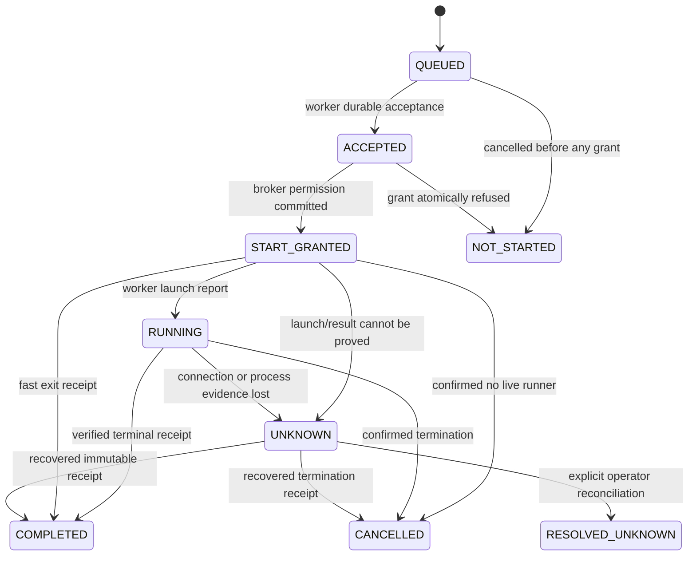

# Protocol and durable state contract

Normative for the initial implementation. `MUST` denotes a release requirement. Version the wire protocol independently from plugin, Hermes and ledger versions. No network transport is implemented yet.

## 1. Identifiers and encoding

- `protocol_version`: integer `1`; exact match required initially.
- `profile_id`: random UUID created once in profile-scoped broker state.
- `worker_id`: operator-selected stable slug, 1–64 ASCII letters/digits/underscore/hyphen.
- `worker_instance_id`: new UUID each worker process start.
- `project_id`: random UUID for an explicitly registered local project; display alias is not identity.
- `binding_id`: broker UUID, immutable association of profile, worker instance, project and generation.
- `generation`: durable positive integer, incremented only for an explicitly accepted replacement binding.
- `environment_id`: opaque UUID, allocated per native environment lifetime.
- `operation_id`: UUID created before first dispatch and reused for delivery/recovery of that operation.
- `request_nonce`: fresh 128-bit-or-larger random value for every HTTP attempt, including retries.

Encode JSON as UTF-8, sorted keys, compact separators, no NaN/Infinity and no duplicate object keys. Validate exact field types; booleans are not accepted as integers. UUIDs are canonical lowercase hyphenated strings. Protocol metadata strings contain no newlines/NUL; shell text is a separately bounded field and may contain newlines. Additive optional fields may be ignored only when explicitly specified; required behavior changes need a new protocol version.

`payload_sha256` is the digest of canonical immutable execution payload: binding, generation, environment, operation, script, login flag, stdin bytes and timeout. IDs are never constructed from shell text. Reuse of an operation ID with another digest fails with `PAYLOAD_CONFLICT` and fences the binding.

## 2. Execution envelope

```json
{
  "protocol_version": 1,
  "profile_id": "11111111-1111-4111-8111-111111111111",
  "binding_id": "22222222-2222-4222-8222-222222222222",
  "generation": 1,
  "environment_id": "33333333-3333-4333-8333-333333333333",
  "operation_id": "44444444-4444-4444-8444-444444444444",
  "worker_id": "local-dev",
  "worker_instance_id": "55555555-5555-4555-8555-555555555555",
  "project_id": "66666666-6666-4666-8666-666666666666",
  "script": "cd /workspace && python -m unittest",
  "login": false,
  "stdin_b64": "",
  "timeout_seconds": 120,
  "payload_sha256": "<computed 64-character lowercase hex digest>"
}
```

Example IDs/digest placeholders are explanatory and must not appear as fixed runtime values. `script` is the native BaseEnvironment-wrapped command, not a second shell template invented by the broker. The worker never inserts the script into host shell strings. Worker runner uses bash argv with the script as one argument, or a private source file in container scratch where length demands it. User stdin is transmitted exactly once to bash, through a channel separate from runner control.

Transport is not a new command authorization layer. The adapter submits only the command already routed by Hermes. Management endpoints cannot ask the native environment to execute shell on behalf of an unauthenticated HTTP caller.

## 3. Worker HTTP API

API base `/v1/worker`. Each endpoint requires request authentication. No admin endpoint is mounted on this listener.

| Method/path | Input | Output and invariant |
|---|---|---|
| `POST /hello` | identity, protocol, project ID/alias, image/runtime capabilities | readiness or explicit binding conflict; never chooses worker paths |
| `POST /heartbeat` | instance, binding/generation, active operation ID | lease deadline and pending cancel/close flags |
| `POST /poll` | instance/binding, max wait ≤2 seconds | zero/one envelope; redispatch preserves operation ID/hash |
| `POST /accept` | operation ID/hash and durable worker acceptance | one idempotent start grant if binding is active and uncancelled |
| `POST /running` | grant ID, operation and runner identity | acknowledgement; missing ack never causes a second spawn |
| `POST /output` | operation, sequence, offset, bytes and chunk digest | durable contiguous acknowledgement |
| `POST /result` | terminal receipt, output digest/count, runner termination facts | idempotent receipt acknowledgement |
| `POST /recover` | bounded list of unresolved operation IDs and local receipts | missing receipt requests/canonical states; no new command execution |

The worker must persist acceptance before `/accept`. Broker commits `START_GRANTED` and a unique `start_grant_id` before returning permission to launch. A repeated `/accept` returns the same grant if valid, or refusal; it cannot allocate a second operation. Grant identity includes generation/instance and has a bounded launch window. Expired grants are never silently replaced after launch intent exists.

On a lost grant response, the worker repeats `/accept` for the same ID/hash using a new request nonce. Once it records `LAUNCHING`, a process restart must reconcile and must not automatically spawn again. This is a two-stage dedup protocol, not exactly-once execution.

Use JSON error envelope `{ "ok": false, "code": "...", "message": "...", "operation_id": null }`. HTTP 400: malformed; 401: failed signature; 409: stale/conflict/fence; 413: limits; 429: capacity; 503: storage/runtime unavailable. Worker retries safe transport requests with backoff; terminal conflicts do not produce an infinite reconnect loop.

Redirects are never followed. Connection, body-read and request deadlines are bounded separately. Do not retain a worker request thread waiting for a native operation to complete.

## 4. Request authentication

Header fields: `X-WBL-Version`, `X-WBL-Worker`, `X-WBL-Instance`, `X-WBL-Time`, `X-WBL-Nonce`, `X-WBL-Body-SHA256`, `X-WBL-Signature`. These metadata fields have strict length/character constraints and are omitted from logs.

Canonical signing input is newline-separated, in this exact order:

```text
WBL1
HTTP_METHOD_IN_UPPERCASE
EXACT_API_PATH_WITHOUT_QUERY
UNIX_TIMESTAMP_SECONDS
REQUEST_NONCE
WORKER_ID
WORKER_INSTANCE_UUID
LOWERCASE_SHA256_OF_RAW_BODY
```

No trailing newline. The signature is lowercase hex HMAC-SHA256 with the decoded 32-byte-or-larger worker key. Reject path/query normalization differences rather than guessing the caller's intention. Decode one canonical key format during setup, e.g. hex; do not accept ambiguous formats at runtime.

Verify bounded body digest, configured worker ID/key, protocol, ±30-second timestamp tolerance, then signature with constant-time comparison. Atomically insert a nonce into a ledger table unique on credential generation/worker/nonce before handling the endpoint. Nonces persist for 120 seconds; reject replay even when it repeats an idempotent result upload. Legitimate retries use a fresh nonce and the same operation identity.

Bound nonce storage and rate-limit failed requests by peer/worker without logging keys. Clock mismatch produces an actionable sync-clock error and no execution. Worker leases use local monotonic clocks, not client timestamps.

TLS authenticates the server and protects confidentiality. HMAC does not replace HTTPS. Key rotation is a manual quiescent restart: refuse active work, replace the Hermes-owned key and explicitly provide it to the worker. Old requests and grants cease to be accepted. Do not persist the raw key in either ledger.

## 5. Private host control API

Unix socket under an owner-only profile-scoped directory; socket mode 0600. Use Linux peer-UID verification. Resolve a too-long Unix path through an explicitly configured owner-only shorter directory, not a public `/tmp` socket. No fallback TCP admin listener.

Framing: 4-byte unsigned network-order body length followed by bounded canonical JSON. Authenticate by peer owner. One request per connection initially; fixed response framing. Validate size before allocation and use monotonic read/write deadlines. Control operations:

`status`, `bind`, `submit`, `operation_status`, `read_output`, `cancel`, `close_environment`, `reconcile_receipts`, `resolve_unknown`, `shutdown`.

`resolve_unknown` and `shutdown` are operator-management requests, never worker HTTP actions or model tools. `submit` is an adapter request with immutable binding IDs; it cannot alter worker registration. Durable journal transitions do not depend on the client keeping its IPC connection open.

## 6. Host state machine



The diagram abbreviates startup transport delivery: an envelope may be sent multiple times before ACCEPTED, but never with a new ID. `cancel_requested` is orthogonal and can be set in any nonterminal state. Fence the generation whenever a start-granted/running operation loses proof, termination is pending, output integrity fails without bounded termination, or a conflicting payload is observed.

`NOT_STARTED` is allowed only with durable evidence that no valid start grant was issued, or an explicit worker receipt proving launch was never attempted and that the grant is revoked. Lack of a response is not that evidence. Normal command failure (e.g. test exit 1) is `COMPLETED`, with that exact exit code.

`RESOLVED_UNKNOWN` retains the original unknown history and operator note. It has no success exit code. Clearing its fence authorizes future distinct operations, not replay of the old one.

## 7. Worker state machine and launch crash windows

Worker ledger: `ACCEPTED → GRANTED → LAUNCHING → RUNNING → TERMINAL`; `UNKNOWN` may replace any state after GRANTED when process evidence is lost. Acceptance, grant and launch intent are separately committed.

| Crash window | Recovery behavior |
|---|---|
| Before acceptance commit | envelope may be accepted later using same operation ID |
| After acceptance, before start grant | repeat acceptance; no spawn without valid grant |
| Grant received, before launch intent | verify grant validity and broker state; revoke safely if expired |
| Launch intent committed, before PID/runner recorded | assume uncertain; do not spawn again |
| After spawn, before running report | reconcile local runner/container evidence; no second spawn |
| After filesystem effects, before receipt commit | uncertain effects; stop runner/container and fence |
| After terminal receipt commit, before upload | resend stored receipt/output; never rerun |
| Host receipt committed, before HTTP acknowledgement | duplicate matching receipt succeeds idempotently |

On startup the worker inventories only its own labeled containers/runner state. It does not scan unrelated files or stop another user's container. Labels include worker instance, binding and environment IDs; reject ambiguous/mismatched container ownership. After a restart, old-instance environments are stopped or explicitly reconciled before a new instance is accepted.

## 8. Output and terminal receipts

Chunk fields: operation ID, sequence starting at 0, byte offset starting at 0, base64 bytes and SHA-256 chunk digest. Maximum raw chunk 64 KiB. Broker commits a chunk before acknowledging; retries of the same sequence/hash/offset are idempotent. Different bytes at an existing sequence cause `OUTPUT_CONFLICT`. Missing/reordered chunks are refused with the expected offset; worker retransmits from its durable spool.

The worker concurrently drains output, uploads chunks and renews the lease. Bound spool storage so a stalled network cannot fill disk. A full spool cancels the process, marks limit failure/uncertainty and fences if termination remains unknown. Control/heartbeat capacity is reserved.

Terminal receipt fields:

```text
operation_id, payload_sha256, binding_id, generation,
worker_instance_id, start_grant_id,
terminal_kind = completed | cancelled | not_started,
exit_code = integer | null,
output_bytes, output_sha256, last_sequence,
termination_confirmed = boolean,
termination_method = natural | group_term | group_kill | container_stop | never_started,
output_complete = boolean,
error_code = string | null,
worker_elapsed_ms = nonnegative integer
```

A completed receipt requires an actual process exit code, verified final output count/digest, and no unresolved child/runner lifecycle. A shell exits with a partial-output limit failure only as an explicitly unusable result; it cannot be passed to a native file parser as successful data. Zero-byte output has SHA-256 of empty bytes and no chunks. No wall-clock timestamp proves ordering; state/sequence transactions do.

Broker accepts duplicate identical terminal receipts; contradictory receipts fence rather than choose the more convenient answer. Audit records preserve both the conflict and original receipt hash. The adapter verifies the broker's stored receipt before exposing success.

## 9. Cancellation, disconnect and leases

User/core timeout or stop sets cancel_requested durably. Heartbeat/poll responses carry this flag. Worker asks runner to TERM the identified group, waits ≤2 seconds, then KILLs. If descendants cannot be ruled out, stop the whole binding container. Receipt says which action actually confirmed termination. A cancel request racing a natural exit may result in a completed receipt; do not relabel a real exit as cancellation.

Worker daemon monitors the time since its last successful lease renewal using a monotonic clock. At fifteen seconds it terminates/stops the environment and records the result locally. The broker independently marks a missing worker unavailable and fences start-granted/running work. A container-local watchdog must also stop active runner processes if the worker daemon dies while the broker lease can no longer be renewed. Do not depend exclusively on an in-memory worker thread surviving SIGKILL.

Watchdog renewal uses a runner control path unavailable to the model bash child as a credentialed broker operation. The watchdog is a fail-stop mechanism, not an adversarial sandbox boundary against malicious code in the same container. The worker also reconciles/stops surviving labeled containers on restart. If the watchdog cannot be proved for daemon death, detached process claims cannot ship.

A reconnect uploads stored receipts first. It does not unlock a generation, change project binding, restart lost commands or create a fresh operation for an old request. Lease expiry stops execution; it does not roll back filesystem effects.

## 10. Ledger schema, storage and retention

Broker tables:

- `meta(schema_version, profile_id, credential_generation, created_at)`
- `worker_registration(worker_id, instance_id, project_id, alias, capability_json, state)`
- `bindings(binding_id, generation, environment_id, state, fence_reason, last_lease)`
- `operations(operation_id, binding_id, payload_sha256, payload_ref, state, grant_id, cancel_requested, receipt_json, receipt_sha256, created_at, updated_at)`
- `output_chunks(operation_id, sequence, offset, byte_count, digest, spool_ref)`
- `events(event_id, operation_id, event_kind, old_state, new_state, safe_metadata_json)`
- `request_nonces(credential_generation, worker_id, nonce, expires_at)`

Worker has analogous operations/chunks/events plus project registrations and container/runner identity. Add unique keys and foreign keys for every relationship. Store payloads/spools as private files with atomic write/rename, then publish a database reference; startup removes unreachable orphan spools only within its own directory. A missing referenced spool is an integrity failure, never regenerated by rerunning a command.

One database writer per service, transactional compare-and-swap state transitions and `synchronous=FULL`. WAL use and filesystem support are checked. Unknown schemas and failed migrations refuse startup. Do not use a second connection's unlocked updates for binding fences.

Default retention: unresolved operations/receipts retained until explicit resolution; complete payload/stdin spools removed after terminal acknowledgement, keeping hashes/receipts; output retained up to 24 hours subject to quota; compact nonsecret receipts/events seven days. Never delete dedup tombstones for an active generation. After a generation closes and expires, retain a closed-generation tombstone so delayed requests are refused. Purge obeys fences and quota; it does not erase the only evidence of uncertain work.

Raw payload/stdin/output can contain project secrets. File permissions and retention limit exposure; no encryption-at-rest claim is made. Neither ledger contains the transport key or Hermes/vendor credentials.
