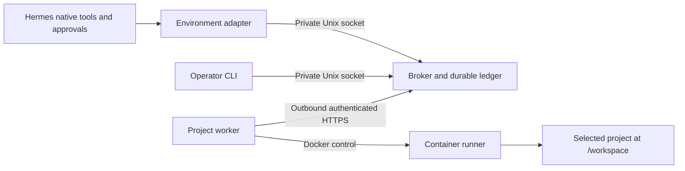
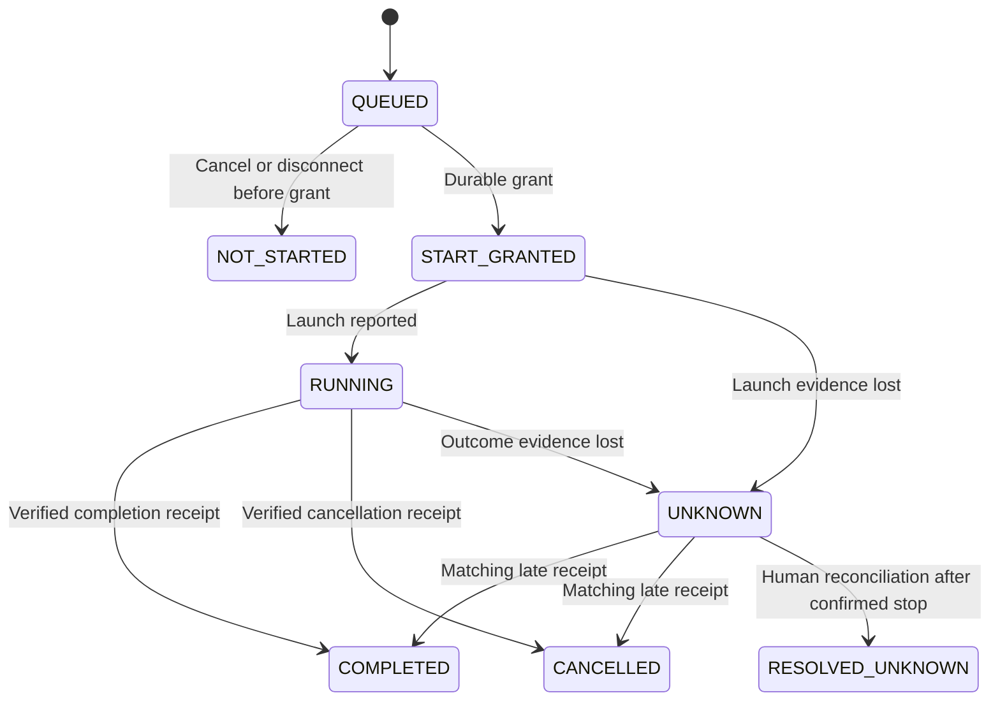

# Architecture

Workbench Link connects Hermes's native execution environment to one project selected on a Linux worker. File tools, terminal commands and persistent code kernels share the same container and shell state. The Hermes host retains its own reasoning, memory and credentials.

## Components

The plugin registers a public `TerminalEnvironmentProvider`, management CLI and read-only status command. Registration starts no service. The operator launches the broker and worker explicitly, then accepts the worker's exact instance, project and image identities.

The broker owns the profile's operation ledger and two distinct interfaces: private Unix IPC for Hermes/operator requests and a bounded HTTP API for the worker. It issues durable start grants and verifies output and receipts. It never executes project commands.

The worker chooses the project locally, maintains its own launch/receipt journal and controls Docker through fixed arguments. It polls for work and uploads output; an independent heartbeat keeps cancellation and lease renewal moving during execution. Project commands run inside the container.

The PID-1 runner separates control messages from command stdin, launches Bash process groups and supervises their lifetime. It reports exact output bytes, exit status, process inventory and termination evidence.

## Source layout

The repository uses a compact Python package with explicit module responsibilities:

| Path | Responsibility |
|---|---|
| `plugin.yaml`, root `__init__.py` | Hermes directory-plugin manifest and relative registration entrypoint |
| `workbench_link/plugin.py` | Public Hermes provider, configuration and command registration |
| `workbench_link/environment.py` | `BaseEnvironment` adapter and pipe-backed process handle |
| `workbench_link/cli.py`, `control.py` | Operator commands and bounded private IPC client |
| `workbench_link/broker.py` | Private IPC server, worker HTTP endpoints and lease monitoring |
| `workbench_link/ledger.py` | Binding, environment and operation state transitions |
| `workbench_link/store.py` | Private SQLite transactions, durable spools and event storage |
| `workbench_link/worker.py` | Selected-project worker, Docker lifecycle and receipt recovery |
| `workbench_link/runner.py` | In-container process supervisor |
| `workbench_link/protocol.py`, `auth.py`, `transport.py` | Shared schemas, authentication and verified HTTP transport |
| `workbench_link/settings.py`, `errors.py` | Validated settings and stable error codes |
| `tests/unit/`, `tests/integration/` | State/socket tests and actual Docker/Hermes integration |
| `docs/`, `.github/` | Technical references, contributor guidance and CI |

The root entrypoint imports the package relatively for Hermes's namespaced directory loader. The worker and shared runtime modules import no Hermes modules; they also run from an installed wheel. `plugin.py` and `environment.py` contain the Hermes-specific integration. A flat package keeps these boundaries visible without introducing parallel implementations or extra import layers.

## Execution and recovery

Each operation captures immutable profile, binding, generation, environment, worker and project identities. The broker commits a start grant before the worker may launch. The worker commits its launch intent before writing to the runner. Duplicate delivery retains the same operation ID and payload hash; conflicting payloads fence the binding.

Chunks have contiguous offsets and individual hashes. Spools are published with fsync and atomic rename before database references; receipts verify the final count and digest. SQLite uses WAL, FULL synchronization and serialized transactions. Recovery resends historical receipts and never relaunches uncertain commands. A known late receipt establishes the original outcome while the execution fence remains until an explicit reset.

## Process lifetime

A native foreground receipt can leave an environment-owned kernel or background job running. Session ownership is recorded at grant time, so losing the launch receipt cannot hide detached work. Subsequent native requests are bounded and serialized to preserve shell state while allowing kernel file RPC.

Native process teardown uses PID/start-time identity and process-tree control. Cancellation escalates TERM/KILL. Environment closure waits for confirmed container-stop evidence, then closes its inventory. Broker restart or lease loss fences potentially live sessions, including sessions whose launch operation already completed. The runner stops children on control EOF or a fifteen-second renewal timeout.

## Trust and scope

The worker container mounts only the selected project. It runs as the worker user's UID/GID, with no network, a read-only root, dropped capabilities, bounded resources and writable scratch. It receives no transport key, Docker socket or host-home mount. Normal Hermes approvals remain active.

The selected project, commands, stdin and returned output are visible to Hermes and retained in private state. Cancellation cannot undo edits. The watchdog handles failures in trusted project execution; it does not isolate hostile code running as the same container user.

Version 0.1.0 supports one foreground CLI profile/environment and one Linux/Docker worker. Gateway multiplexing, delegated environment isolation, PTY/background stdin, jobs surviving environment closure, automatic file synchronization and other worker platforms are outside this scope. See [protocol](protocol.md), [compatibility](compatibility.md) and [verification](verification.md) for the detailed contracts and measured coverage.
